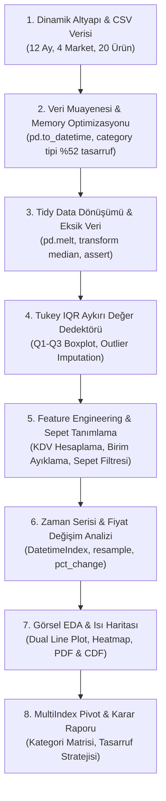

# 🛒 Süpermarket Fiyat Trendleri & Bütçe Tasarruf Analizi
### Retail Price Trends & Consumer Basket Optimization

<div align="center">


<br/>

**12 aylık perakende süpermarket verisi üzerinde veri temizleme, zaman serisi analizi, Tukey IQR aykırı değer yönetimi, görselleştirme ve MultiIndex pivot tablo teknikleriyle uçtan uca dinamik veri bilimi projesi.**

[Proje Mimarisi](#-proje-mimarisi--8-aşamalı-akış) • [Bulgular & Tasarruf Raporu](#-temel-bulgular--karar-raporu) • [Dinamik Yapılandırma](#-dinamik-tak-çalıştır-kullanım-config) • [Kurulum & Çalıştırma](#-kurulum-ve-kullanım)

</div>

---

## 📌 Proje Genel Bakışı (Overview)

Bu proje, veri biliminde sıkça karşılaşılan dağınık, eksik ve aykırı değerler içeren gerçek hayat perakende verilerini işleyip **tüketici sepet optimizasyonu ve pazar dinamikleri raporuna** dönüştüren kapsamlı bir analiz boru hattıdır (*data pipeline*).

### 🎯 Temel Yetkinlikler ve Çözülen Problemler:
1. **Dinamik Tak-Çalıştır Mimari (`Plug & Play`):** Kullanıcı farklı bir market zinciri veya kendi alışveriş fişlerini getirdiğinde kodları değiştirmeden yalnızca tek bir `CONFIG` sözlüğü üzerinden analiz hattını çalıştırabilir.
2. **Geniş Format - Tidy Data Dönüşümü:** Yatay sütunlardaki market fiyatlarını `pd.melt()` ile dikey uzun forma çevirme ve bellek optimizasyonu (`category` tipi ile %52.2 tasarruf).
3. **Akıllı Veri Temizliği:** Eksik verileri (`NaN`) ürün/ay bazında grup medyanı ile doldurma ve `assert` kontrolleriyle doğrulama.
4. **Tukey IQR Aykırı Değer Dedektörü:** $1.5 \times IQR$ kuralı ile hatalı veri girişlerini (950 TL maden suyu, 12 TL zeytin) tespit edip düzeltme.
5. **Zaman Serisi & Resampling:** `DatetimeIndex` üzerinden aylık yeniden örnekleme (`resample('MS').mean()`) ve kümülatif sepet fiyat artış eğrilerini çıkarma.
6. **İleri Tablo & MultiIndex Pivot:** `pivot_table()`, `unstack()`, `stack()` ve çoklu toplulaştırma (`agg(['min','mean','max','std'])`).

---

## 🗺️ Proje Mimarisi & 8 Aşamalı Akış



---

## 📊 Temel Bulgular & Karar Raporu

### 1. 🛒 Yıllık Toplam Temel Sepet Harcaması (12 Ay Toplamı)
6 temel tüketim ürününden (Süt, Peynir, Yumurta, Ekmek, Domates, Ayçiçek Yağı) oluşan sepetin market bazında yıllık toplam maliyeti:

| Sıra | Market | Yıllık Toplam Maliyet | Piyasa Konumu | Tasarruf Potansiyeli |
| :---: | :--- | :---: | :---: | :---: |
| 🥇 | **Market_B** | **6.641,93 TL** | 🏆 En Ekonomik Market | Referans Baz |
| 🥈 | **Market_C** | **6.803,68 TL** | İkinci En Uygun | +161,75 TL |
| 🥉 | **Market_D** | **7.125,07 TL** | Üçüncü | +483,14 TL |
| 🚨 | **Market_A** | **7.336,64 TL** | En Pahalı Zincir | **+694,71 TL (%9.5 Fark)** |

> 💡 **Tüketici Karar Çıkarımı:** Alışverişlerini Market_A yerine **Market_B**'den yapan bilinçli bir tüketici, aynı sepet için yılda **694,71 TL (%9.5)** doğrudan tasarruf sağlamaktadır.

---

### 2. 📈 Kategori Bazında 2024 Yılı Fiyat Değişim Sıralaması

| Kategori | Yıllık Fiyat Artışı (%) | Dinamik / Sektörel Yorum |
| :--- | :---: | :--- |
| 🥇 **Manav** | **+%44.55** | Mevsimsel geçişler, lojistik ve tedarik dalgalanmalarıyla en yüksek artış gösteren grup. |
| 🥈 **Süt & Kahvaltılık** | **+%43.83** | Yem, hayvancılık ve soğuk zincir maliyetleri artış hızında etkili oldu. |
| 🥉 **Temel Gıda** | **+%43.72** | Un, yağ, şeker ve bakliyat grubunda istikrarlı yükseliş trendi. |
| 📦 **İçecek** | **+%42.27** | Fiyat artış hızını en ılımlı tutan kategori. |

---

### 3. 🗺️ Market Fiyat Hareketleri Korelasyon Matrisi (`sns.heatmap`)

Piyasadaki 4 süpermarket zincirinin tüm ürün ve periyotlardaki fiyat hareketleri karşılaştırıldığında:

| Market | Market_A | Market_B | Market_C | Market_D |
| :--- | :---: | :---: | :---: | :---: |
| **Market_A** | **1.0000** | 0.9988 | 0.9989 | 0.9991 |
| **Market_B** | 0.9988 | **1.0000** | 0.9993 | 0.9995 |
| **Market_C** | 0.9989 | 0.9993 | **1.0000** | 0.9993 |
| **Market_D** | 0.9991 | 0.9995 | 0.9993 | **1.0000** |

> 🔍 **Veri Bilimi Çıkarımı:** Marketler arasındaki korelasyon $r \approx 0.999$ seviyesindedir. Perakendeciler bağımsız fiyat politikası gütmek yerine toptan girdi maliyetlerini ve rakip etiketlerini neredeyse eşzamanlı olarak takip etmektedir.

---

## 🛠️ Dinamik Tak-Çalıştır Kullanım (`CONFIG`)

Kendi verinizi (örneğin kendi market fişlerinizi) analiz etmek istediğinizde, [Supermarket_Price_Analysis.ipynb](./Supermarket_Price_Analysis.ipynb) içerisindeki 1. hücrede yalnızca şu sözlüğü güncellemeniz yeterlidir:

```python
PROJECT_CONFIG = {
    # 1. Veri Dosyası Yolu
    "file_path": "supermarket_data.csv",
    
    # 2. Sütun Eşlemeleri
    "columns": {
        "date": "Tarih",          # Tarih sütunu
        "product": "Urun",        # Ürün adı
        "category": "Kategori",   # Ürün kategorisi
        "price": "Fiyat",         # Fiyat sütunu (Uzun formatta)
        "market": "Market"        # Market adı sütunu
    },
    
    # 3. Format Seçimi
    "is_wide_format": True,
    "market_columns": ["Market_A", "Market_B", "Market_C", "Market_D"],
    
    # 4. İzlenecek Tüketim Sepeti
    "target_basket": [
        "Süt (1L)", "Yumurta (10'lu)", "Ekmek (Adet)",
        "Zeytinyağı (1L)", "Beyaz Peynir (500g)", "Domates (1kg)"
    ]
}
```

---

## 📂 Dosya Yapısı

```
Supermarket_Fiyat_Analizi_Projesi/
├── README.md                          # Proje detaylı dokümantasyonu ve raporu
├── supermarket_data.csv               # 240 satır x 7 sütun 12 aylık perakende veri seti
├── Supermarket_Price_Analysis.ipynb   # 8 aşamalı uçtan uca Jupyter Notebook (30 kod hücresi)
├── SUPERMARKET_PROJECT_PLAN_AND_TODO.md # Canlı takip listesi & metodoloji planı
├── create_supermarket_dataset.py       # Sentetik ama gerçekçi veri üreteci
└── build_notebook.py                  # Otomatik ve hatasız notebook derleyici script
```

---

## 🚀 Kurulum ve Kullanım

### 1. Depoyu Klonlayın
```bash
git clone https://github.com/Rasittekin18/data-science-roadmap.git
cd data-science-roadmap/Supermarket_Fiyat_Analizi_Projesi
```

### 2. Gerekli Kütüphaneleri Yükleyin
```bash
pip install pandas numpy matplotlib seaborn jupyter
```

### 3. Notebook'u Başlatın
```bash
jupyter notebook Supermarket_Price_Analysis.ipynb
```
veya tüm analizi baştan yeniden derlemek için:
```bash
python build_notebook.py
```

---

## 📄 Lisans

Bu proje **MIT Lisansı** altında açık kaynaklı olarak paylaşılmaktadır.
